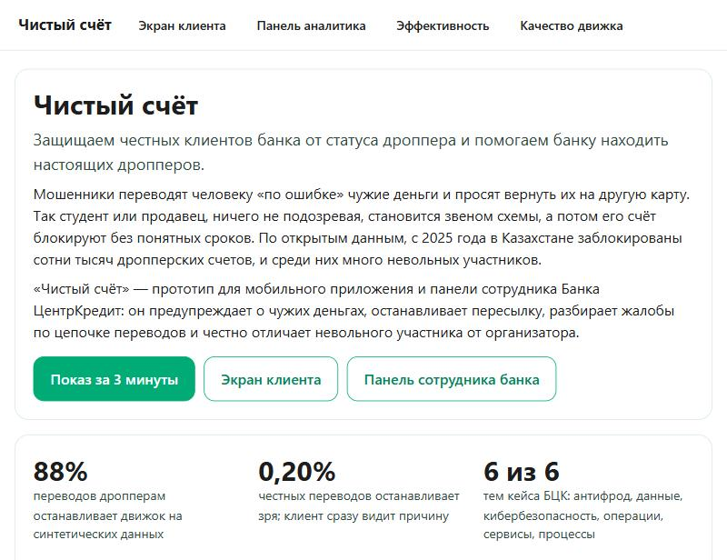
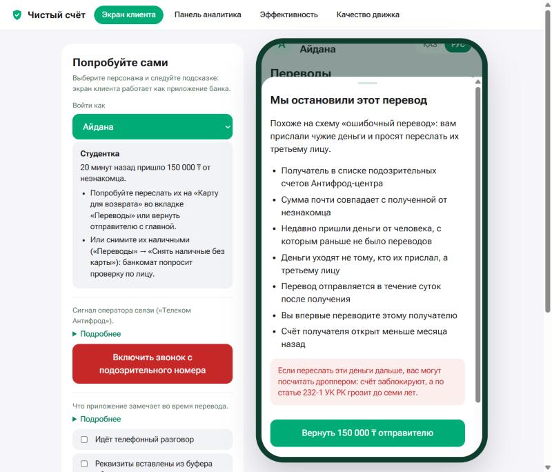
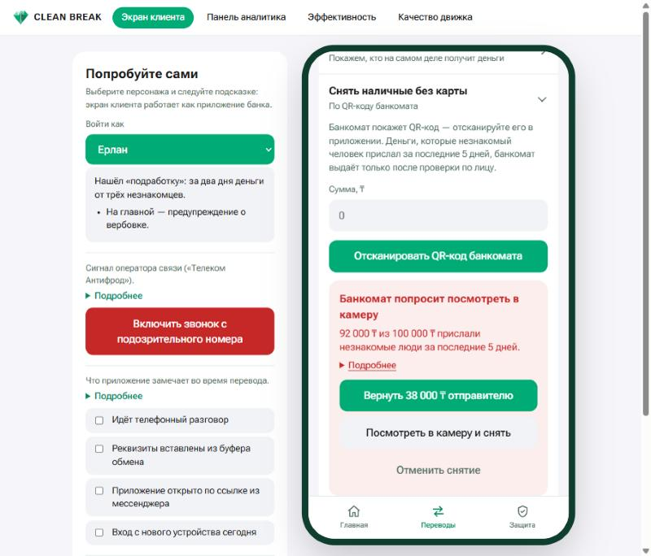
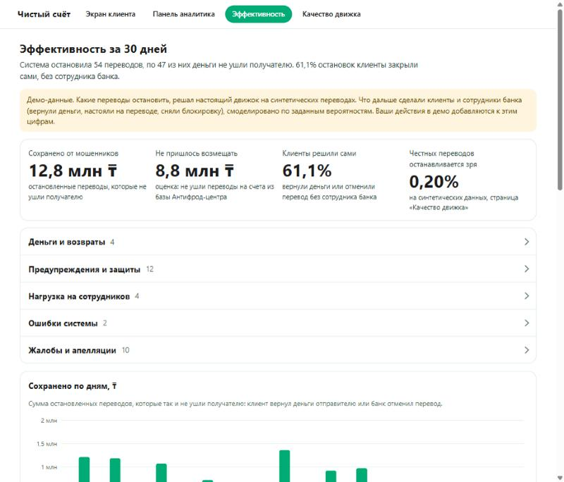

# Чистый счёт

**Защищаем честных клиентов банка от статуса дроппера и помогаем банку находить настоящих дропперов.** Прототип мобильного приложения и панели сотрудника банка для V Регионального ITU Hackathon-2026, кейс Банка ЦентрКредит.

Мошенники переводят человеку «по ошибке» чужие деньги и просят вернуть их на другую карту. Так студент или продавец, ничего не подозревая, становится звеном схемы, а потом его счёт блокируют без понятных сроков. «Чистый счёт» предупреждает о чужих деньгах, останавливает пересылку, разбирает жалобы по цепочке переводов и честно отличает невольного участника от организатора.



| Клиент | Сотрудник банка |
| --- | --- |
|  |  |
| Перевод «вернуть ошибочный перевод» на другую карту остановлен, причины — простыми словами, деньги можно вернуть отправителю одной кнопкой | Граф денег по жалобе, подсказка «невольный участник или организатор», скрытые ИИН и телефон, решение принимает человек |
|  |  |
| Ерлан снимает присланные незнакомцами деньги — банкомат выдаёт их только после проверки по лицу, вместо снятия можно вернуть отправителю | Сохранено, «Не пришлось возмещать», доля закрытых самими клиентами остановок и ошибок — сверху, подробности раскрываются по разделам |


## Главное за минуту

- **88%** переводов дропперам движок останавливает на синтетических данных, **0,20%** честных — зря, и клиент сразу видит причину. Решение по переводу — около **3 мс**.
- Больше 20 защит по всем шести темам кейса: антифрод, защита клиентов и данных, кибербезопасность банковских систем, безопасность операций, цифровые сервисы, рабочие процессы банка.
- Все тексты для клиента на русском и казахском. 167 автотестов.
- Запуск без настройки: `pip install -r requirements.txt`, `uvicorn app.main:app`, затем кнопка «Показ за 3 минуты» на стартовой странице.

## Что у банков уже есть и что нового

| Уже есть у банков | Нового в «Чистом счёте» |
| --- | --- |
| Кнопка «вернуть отправителю» (у некоторых банков) | Перехват пересылки чужих денег с объяснением; возврат без проверки — только в пределах присланной суммы |
| Блокировка дропперских счетов | Соразмерная блокировка: у невольного участника заморожена только спорная сумма; апелляция в приложении со сроком ответа, справка с проверкой по коду |
| Поиск дропперов, который видит только банк | Работа с клиентом: «светофор получателя» до перевода, «Сейф», «Меня втянули в схему», «Счёт открыли без меня» |
| Жалоба в чат или колл-центр | Жалоба идёт по цепочке переводов, в том числе в другой банк; пострадавший видит статус и получает готовое заявление в полицию |
| Снятие наличных и оплата по QR-коду | Деньги незнакомцев за последние 5 дней банкомат выдаёт только после проверки по лицу, а жалоба пострадавшего видит снятые наличными деньги; крупное снятие во время подозрительного звонка — через час, доверенное лицо может отменить. Перед оплатой по QR видно, кто на самом деле получит деньги: подменённый код на парковке виден сразу |
| Статьи и викторины о мошенниках | Тренажёр в приложении: 8 ситуаций из схем кейса с объяснением сразу после ответа; банк видит, на каких схемах клиенты ошибаются чаще |
| Отдельные правила против мошенников | Сети дропперов и дроп-фермы, «аренда ИП», касса онлайн-казино; журнал, который нельзя подделать; правило двух ключей для сотрудников; настройка весов по решениям сотрудников |

## Запуск

```
pip install -r requirements.txt
uvicorn app.main:app --reload   # стартовая страница: http://127.0.0.1:8000, экран клиента: /client, панель аналитика: /analyst
python -m pytest -q             # тесты
python -m app.seed              # необязательно: пересоздать базу и напечатать качество движка
python -m app.quality           # пересчитать страницу качества /quality (10 наборов данных, 6–8 минут)
```

При первом запуске сервер около 10 секунд готовит демо-данные: прогоняет через движок историю переводов за 30 дней для панели эффективности (`CA_DEMO_HISTORY=0` отключает историю и ускоряет запуск).
Какие переводы остановить, в этой истории решает настоящий движок; что дальше сделали клиенты и сотрудники, смоделировано по вероятностям в `app/history.py`, и страница это прямо пишет.

Демо-данные создаются сами при первом запуске и пересоздаются, если им больше 48 часов:
иначе «свежий» входящий перевод устаревает и перехват перестаёт срабатывать.
Кнопка «Сбросить демо» в панели аналитика возвращает исходное состояние в любой момент.

Код доступа в панель аналитика задаётся переменной `CA_ANALYST_PIN` (по умолчанию `2026`).

Экран клиента работает на русском и казахском: переключатель ҚАЗ / РУС вверху. Сообщения сервера (причины остановки, ошибки, статусы) приходят на выбранном языке. Панель аналитика на русском. Казахские тексты собраны в `app/i18n.py` и в начале `app/static/index.html`; перед показом их стоит вычитать носителю языка.

## Сценарий показа

Быстрее всего — кнопка **«Показ за 3 минуты»** на стартовой странице: тур сам переключает персонажей, вкладки и случаи, подсвечивает, куда смотреть, и проходит 12 шагов от предупреждения Айданы до журнала и эффективности (среди них снятие наличных у Ерлана и проверка QR-кода у Мамы). На шагах сотрудника банка нужно один раз ввести код доступа. Стартовая страница коротко объясняет проблему, показывает главные цифры и карту защит по шести темам кейса. В демо-панели экрана клиента персонажи сгруппированы по историям: защита от мошенников, пострадавшие, невольные участники и вербовка, счета мошенников, бизнес.

Экран клиента открывается как телефон с вкладками «Главная», «Переводы» и «Защита». На «Переводах» (перевод, оплата по QR-коду, снятие наличных) и «Защите» (сейф, проверка сообщения, тренажёр, доверенное лицо, «Вас втянули в схему?», кто смотрел данные) карточки собраны в аккордеон: открыта одна, у остальных виден заголовок и строка о том, что внутри. Слева демо-панель: в ней выбирают персонажа, читают подсказку, что попробовать, имитируют звонок мошенника и вставляют примеры сообщений. На узком экране демо-панель сворачивается в кнопку сверху.

1. **Айдана (студентка)** получила 150 000 ₸ от незнакомца. Приложение сразу предупреждает: «Возможно, это чужие деньги» и предлагает вернуть их отправителю одной кнопкой. Если она всё же попытается переслать деньги на «карту для возврата», перевод остановится.
2. **Гульнар** оплатила телефон по объявлению на карту Данияра, а мошенник уговорил Данияра «вернуть ошибочный перевод» на другую карту. Гульнар нажимает «Это были мошенники?» у своего перевода.
3. Система идёт по цепочке переводов (до трёх звеньев): **Данияр** уже переслал деньги дальше, а на **карте «для возврата»** они остались. **Соразмерная блокировка:** Данияр по правилам похож на невольного участника, поэтому у него заморожена только спорная сумма (5 000 ₸, остаток от перевода Гульнар). Остальными деньгами он пользуется, но переводить может только тем, кому переводил раньше (например, своему поставщику). «Карта для возврата» похожа на дропперскую и закрыта целиком. Данияр видит причину простым языком и срок ответа, прикладывает переписку и подаёт апелляцию. Он может сам вернуть Гульнар замороженные 5 000 ₸, не дожидаясь решения банка.
4. **Сотрудник банка** (`/analyst`, код `2026`) открывает случай Данияра: **граф денег** (Гульнар → Данияр → «карта для возврата», и в ту же карту сходятся деньги Руслана; остановленные переводы пунктиром, возвраты подписаны), подсказка «похоже на невольного участника», история. Нажатие на счёт в графе открывает его случай. Он снимает ограничения и при необходимости выгружает сведения для Антифрод-центра. Если сотрудник не согласен с подсказкой, он одной кнопкой закрывает счёт целиком. Там же видно, что «карта для возврата» теперь связана с двумя независимыми случаями (Руслан и Данияр). Для контраста в очереди есть **Руслан**: счёту 12 дней, четыре пересылки от разных людей.
5. **Возврат пострадавшей** (случай «карты для возврата» в панели): сотрудник просит вернуть Гульнар 195 000 ₸, которые остались на карте, второй сотрудник подтверждает (правило двух ключей, п. 23). Больше, чем она перевела, уйти не может. Гульнар на своём экране видит карточку обращения: сколько денег заморожено в цепочке и сколько ей уже вернули.
6. **Связанные счета** (вкладка в панели): карты, которые получали деньги от разных клиентов в разных случаях; такую карту можно приостановить одной кнопкой.
7. **Списки Антифрод-центра и звонок** (на экране Мамы): перевод «Инвестплатформе «Профит»» из «чёрного» списка не проходит; «карта для возврата» в «сером» списке, и клиент видит предупреждение ещё при выборе получателя. Кнопка в демо-панели слева имитирует сигнал оператора связи о подозрительном звонке: появляется предупреждение, а перевод новому получателю («Безопасный счёт») останавливается, его можно отменить.
8. **Доверенное лицо** (Мама → Айдана): Мама назначила дочь доверенным лицом. Когда во время звонка мамин перевод на «Безопасный счёт» останавливается, Айдана сразу видит это на своём экране и может отменить перевод. Если мама настаивает, перевод уходит сотруднику только после подтверждения Айданы. Отключить доверенное лицо можно, но это вступает в силу через сутки: мошенник не уговорит «убрать контроль» за один звонок.
9. **Предупреждение о вербовке** (Ерлан): за два дня ему прислали деньги три незнакомых человека, а счёту 45 дней. Вместо трёх отдельных предупреждений он видит одно: «Похоже, через ваш счёт проводят чужие деньги» с объяснением схемы «подработки» и кнопкой «Вернуть всем отправителям». Если он ответит «это мои покупатели» и всё же перешлёт сумму одним переводом, перевод остановится, а сотрудник увидит, что клиента предупреждали.
10. **Справка о снятии ограничений** (Данияр после шага 4): когда сотрудник снимает ограничения, клиент получает справку с номером и кодом проверки. Её можно распечатать или сохранить в PDF и показать в другом банке; подлинность проверяется без входа на `/verify/<код>`. Если счёт снова приостановят, справка становится недействительной.
11. **Проверка сообщения** (любой персонаж): в демо-панели слева семь примеров сообщений мошенников (открывают вкладку «Защита»). Система узнаёт схему («ошибочный перевод», «безопасный счёт» и «встречный кредит», лжеинвестиции, вербовка в дропперы, а также схемы осени 2026: поддельное письмо «от Нацбанка», ложное уведомление о цифровой доверенности или кредитной заявке, поддельный счёт «от налоговой»), показывает, какие слова насторожили, и объясняет, что делать. У Айданы после проверки «ошибочного перевода» сразу появляется кнопка вернуть 150 000 ₸ отправителю. Если клиент проверил опасное сообщение, а потом переводит деньги новому получателю, перевод останавливается.
12. **Период охлаждения** (Мама): перевод 120 000 ₸ на новый «Безопасный счёт» без звонка не останавливается, но уходит только через час. До этого его может отменить сама мама или её доверенное лицо Айдана.
13. **«Вас втянули в схему?»** (Тимур): студент отдал карту «работодателю» из чата, за сутки на неё пришли деньги от двух незнакомцев. На вкладке «Защита» он сам сообщает банку, что произошло, и выбирает вариант: отдал карту (счёт закрывается целиком, им может пользоваться чужой человек), принимал и пересылал (замораживаются только чужие деньги), только предложили (ограничений нет). Обращение сразу попадает сотруднику с пометкой «Сообщил сам», а Тимур получает подтверждение с номером, датой и кодом проверки на `/verify/<код>`. Его можно приложить к заявлению в полицию: примечание к ст. 232-1 УК РК освобождает от ответственности того, кто впервые совершил это, сам заявил и помог раскрытию. Решают правоохранительные органы, банк этого не обещает.
14. **Эффективность** (`/analyst/stats`): сверху четыре главные цифры (сохранено, «Не пришлось возмещать», клиенты решили сами, сколько честных переводов останавливается зря), ниже разделы, которые раскрываются по нажатию: сколько денег сохранено и возвращено за 30 дней, **сколько банку не пришлось возмещать** (переводы на счета из базы Антифрод-центра, которые не ушли: по закону о платежах такой перевод банк возмещает клиенту), сколько вернули пострадавшим по жалобам, сколько остановок клиенты закрыли сами, сколько было соразмерных блокировок, обращений «меня втянули» и остановок денег из свежего кредита, как быстро решаются апелляции и как часто система ошибается.
15. **«Встречный кредит»** (Болат): 40 минут назад ему позвонила «служба безопасности банка» и уговорила взять кредит 800 000 ₸, чтобы «отменить чужую заявку». На главной он видит карточку «Банк никогда не просит оформить кредит…» с кнопкой «Вернуть кредит». Если он переводит деньги на «Безопасный счёт», перевод останавливается: в окне объяснение схемы и кнопка «Вернуть кредит 800 000 ₸». Кредит закрывается, остановленный перевод отменяется. Перевод тех же денег продавцу со старым счётом не останавливается (только период охлаждения).
16. **«Аренда ИП»** (ИП Нурлан и ИП Асель): Нурлан полгода назад торговал одеждой, потом ИП «спал». Три дня назад он за процент передал доступ к счёту: семь незнакомых людей заплатили на счёт ИП, и деньги почти сразу ушли на карты частных лиц. На главной у него карточка «Похоже, счётом вашего ИП пользуется другой человек» с кнопкой «Сообщить банку». Перевод 150 000 ₸ на «Карту для возврата» останавливается. Сотрудник видит счёт во вкладке **«Аренда ИП»** с тремя признаками и приостанавливает его одной кнопкой; клиент видит причину простым языком. Для контраста **Асель** — честный магазин: за неделю ей тоже заплатили 14 новых покупателей, но деньги уходят поставщику, поэтому ни предупреждений, ни остановок нет. У ИП нет предупреждения «возможно, чужие деньги»: платежи от незнакомых людей для магазина — обычная выручка.
17. **«Перевод под диктовку»** (Мама): в демо-панели слева четыре переключателя — что приложение замечает во время перевода: идёт телефонный разговор, реквизиты вставлены из буфера обмена, приложение открыто по ссылке из мессенджера, вход с нового устройства. Включите два и переведите деньги на «Безопасный счёт»: перевод останавливается с окном «Похоже, вам диктуют перевод». Давно знакомому получателю эти признаки не мешают, а для давнего счёта нужно три признака.
18. **Жалоба через другой банк** (Сауле, Арман, Дина): Сауле купила билеты у Армана, а он «вернул ошибочный перевод» на карту в другом банке (в демо — «Банк «Б»»). Сауле жалуется: у Армана замораживается остаток, а в Банк «Б» через Антифрод-центр уходит запрос на заморозку со сроком ответа; Сауле видит это в карточке обращения. Во вкладке **«Другие банки»** сотрудник имитирует ответ банка («заморожено» или «деньги уже ушли») и возврат денег пострадавшей. Обратный путь: Дина получила деньги от клиента Банка «Б» и переслала их на «Карту для возврата». Кнопка «Имитировать запрос другого банка» — и система сама проходит цепочку в нашем банке, замораживает 140 000 ₸ на двух счетах и сразу отвечает. На графе счёт в другом банке показан пунктирной рамкой с ответом банка.
19. **«Сейф»** (Мама): 1,5 млн ₸ из 1,65 млн у Мамы лежат в сейфе на вкладке «Защита». Если мошенник уговорит её перевести 400 000 ₸, перевод не пройдёт: доступно только 150 000 ₸, а деньги в сейфе через приложение не переводятся. Открыть сейф можно через сутки или в отделении по удостоверению (в демо — сразу). Попросите открыть через сутки и войдите как Айдана: она видит «Мама открывает сейф» и может оставить деньги в сейфе.
20. **«Касса онлайн-казино»** (Самат): студенту в чате предложили «принимать платежи» за 3%. За четыре дня двадцать незнакомых людей прислали мелкие суммы, а семерым из них ушли «выигрыши». На главной — предупреждение, что это касса нелегального онлайн-казино. Перевод 25 000 ₸ Гульнар останавливается. Сотрудник в карточке случая видит признаки кассы: одни и те же незнакомцы и платят, и получают деньги.
21. **Сети дропперов и дроп-фермы** (вкладка **«Сети»** в панели аналитика): с двух «дроп-телефонов» входят в приложение счета десяти разных людей — «карта для возврата», «Безопасный счёт», Руслан, Тимур, ИП Нурлан, Самат, счёт, открытый на имя Венеры, и синтетические дропперы. Сотрудник видит сеть целиком: телефоны с признаками фермы, граф (телефоны и пунктир к их счетам, переводы внутри сети), список счетов с тем, что банк о них уже знает и сколько денег пришло извне. Кнопка «Приостановить счета на дроп-телефонах» закрывает счета, которыми управляет один человек; невольных участников сотрудник разбирает по одному. Сведения о сети выгружаются для Антифрод-центра и АФМ. Из карточки случая есть переход «Открыть сеть». У Мамы и Айданы общий семейный планшет — это не ферма.
22. **«Счёт открыли без меня»** (Венера): шесть дней назад на её имя по её данным и поддельному видео удалённо открыли второй счёт — с «дроп-телефона», с которого Венера никогда не входила. Незнакомые люди уже заплатили на него 415 000 ₸ «предоплаты». На главной у Венеры вопрос «Вы открывали этот счёт?». «Это не я» — и счёт сразу приостановлен, на нём заморожено 115 000 ₸, а Венера получает подтверждение с номером, временем и кодом проверки для полиции и суда. Её основной счёт не ограничен: она не дроппер. Сотрудник видит случай «Счёт открыт на чужое имя».
23. **Правило двух ключей** (панель аналитика): над вкладками видно, какой сотрудник работает, и ссылка «Демо: войти как …». Крупный возврат пострадавшей (например, 195 000 ₸ с «карты для возврата»), приостановка сети и решение в пользу клиента, похожего на организатора, один сотрудник не проводит: он просит, второй подтверждает или отклоняет. Подтвердить свою же просьбу нельзя.
24. **Скрытые данные и «Кто смотрел мои данные»**: в карточке случая ИИН и телефон клиента скрыты. «Показать» — только с причиной (связаться с клиентом, проверка документов, запрос правоохранительных органов); каждый просмотр и каждая выгрузка для Антифрод-центра записываются. Клиент видит их на вкладке «Защита»: когда и зачем банк открывал его данные.
25. **Журнал, который нельзя подделать** (страница «Эффективность», внизу): каждая запись журнала хранит отпечаток предыдущей. Кнопка «Демо: изменить запись задним числом» правит запись прямо в базе, как сделал бы сотрудник-сообщник, — проверка сразу показывает, какая запись испорчена. «Сбросить демо» возвращает журнал.
26. **«Светофор получателя»** (вкладка «Переводы», любой персонаж): ещё до нажатия «Перевести» под получателем горит красный, жёлтый или зелёный свет с короткой причиной. У Айданы «Карта для возврата» — красный (серый список Антифрод-центра), Мама — зелёный («давно обмениваетесь переводами»), Ерлан — жёлтый (деньги многих незнакомых людей), счёт в Банке «Б» — жёлтый (проверить нельзя). Подробностей о чужом счёте клиент не видит.
27. **Заявление в полицию за 2 минуты** (Гульнар после жалобы): в карточке обращения кнопка «Заявление в полицию» открывает готовый лист: дата и сумма перевода, получатель, номер обращения в банк, сколько заморожено в цепочке, куда ушли деньги. Выделены места, которые нужно дописать самой. Как подать — по номеру 102, на qamqor.gov.kz или в отделении. Имена других людей из цепочки в текст не попадают.
28. **Калькулятор эффекта для банка** (страница «Эффективность»): впишите число клиентов, переводов и долю мошеннических — калькулятор покажет, сколько денег сохранит система в год, сколько честных переводов остановит зря и сколько часов работы останется сотрудникам. Доли взяты с синтетики и из демо, все допущения видны.
29. **Настройка правил по решениям сотрудников**: на странице «Эффективность» видно, по каким признакам сотрудники чаще всего разрешали остановленный перевод (остановка была лишней). «Проверить вес» открывает страницу качества, где можно поменять баллы признака и сразу увидеть, сколько схем движок будет ловить и сколько честных переводов останавливать. Движок при этом не меняется: вес меняет человек после проверки.
30. **Снятие наличных без карты** (вкладка «Переводы», карточка «Снять наличные без карты»): банкомат показывает QR-код, клиент сканирует его в приложении (в демо — кнопка). У **Айданы** свои деньги — 42 000 ₸, остальное прислал незнакомец 20 минут назад. 40 000 ₸ она снимает сразу. При снятии 50 000 ₸ банкомат просит посмотреть в камеру: 8 000 ₸ из них — деньги незнакомца. Вместо снятия можно вернуть их отправителю; снятие по лицу банк запоминает, и сотрудник видит его в карточке случая. Если незнакомец потом пожалуется, банк увидит, что его деньги сняты наличными, и приостановит счёт так же, как при пересылке дальше. **Мама** во время звонка с подозрительного номера снимает 120 000 ₸ — снятие откладывается на час (схема «курьер»: «снимите деньги и передайте нашему сотруднику»). Айдана как доверенное лицо видит это на главной и отменяет.
31. **Проверка QR-кода перед оплатой** (вкладка «Переводы», карточка «Оплата по QR-коду»): три демо-наклейки. «Парковка» — код подменили, деньги ушли бы на карту частного лица (и это «карта для возврата»): «Похоже, QR-код подменили», кнопки оплаты нет. «Магазин одежды» — настоящий счёт ИП Асель, оплата обычным переводом со всеми проверками. «Кофейня» — счёт в другом банке, проверить нельзя: «Проверьте получателя».
32. **Тренажёр против мошенников** (вкладка «Защита»): 8 ситуаций — «служба безопасности банка», «ошибочный перевод», «подработка», «курьер за наличными», лжеинвестиции, карта «в аренду», поддельный QR-код и одна честная (период охлаждения). После ответа сразу видно, как правильно и почему. Банк хранит только итог и номера ошибок; на странице «Эффективность» видно, сколько клиентов прошли тренажёр и где ошибаются чаще.

## Что внутри

- `app/engine.py`: движок перехвата. Каждый признак даёт баллы и текст причины, перевод останавливается от 85 баллов. Учитывает дробление суммы на части. Отдельно считает подсказку для аналитика «невольный участник или организатор».
- `app/main.py`: API. Вход, переводы, предупреждение о чужих деньгах, безопасный возврат, жалоба пострадавшего и её статус, соразмерная блокировка, возврат пострадавшему, обращение «меня втянули в схему», апелляция со сроком ответа, панель аналитика, журнал действий.
- `app/seed.py`: генератор данных. 300 клиентов, 90 дней истории, схема с дропперами и похожие на неё честные ситуации.
- `app/db.py`: схема базы SQLite.
- `app/i18n.py`: тексты для клиента на русском и казахском.
- `app/vault.py`: шифрование документов клиентов на диске.
- `app/metrics.py`: показатели эффективности и поиск связанных счетов (одна карта в нескольких независимых случаях).
- `app/history.py`: история случаев за 30 дней для демо.
- Списки Антифрод-центра (таблица `afc_list`) и сигналы оператора о звонке (`call_signals`, `POST /telecom/signal`) в демо — имитация: в банке они приходят из Антифрод-центра и от оператора связи по защищённым каналам.
- `app/static/stats.html`: панель эффективности.
- `app/static/index.html`: экран клиента. `app/static/analyst.html`: панель аналитика. `app/static/quality.html`: страница качества.
- `app/quality.py`: расчёт качества по 10 наборам данных, результат в `app/static/quality.json`.
- `app/messages.py`: проверка подозрительного сообщения (правила на русском и казахском).
- `app/trainer.py`: ситуации тренажёра против мошенников на русском и казахском.
- Граф денег в карточке случая (`_graph` в `app/main.py`, рисунок — `drawGraph` в `app/static/analyst.html`, без библиотек): переводы самого случая, цепочка по жалобе, все пересылки клиента за 90 дней, переводы других случаев на ту же «связанную» карту и транзит арендованного ИП. Переводы между двумя счетами складываются в одну стрелку, столбец больше 8 счетов сворачивается в «ещё N счетов». Граф входит и в выгрузку для Антифрод-центра.
- Устройства входа (таблица `devices`), дроп-фермы (`engine.farm_devices`) и сети дропперов (`metrics.networks`): вкладка «Сети» в панели аналитика, граф сети строится тем же кодом, что граф случая (`_graph_build`), телефоны в нём — отдельные узлы. В демо устройства — имитация: в банке их берут из журналов мобильного приложения.
- `app/journal.py`: журнал действий с цепочкой отпечатков (SHA-256) и проверкой целостности.
- `app/static/landing.html`: стартовая страница. `app/static/tour.js`: «Показ за 3 минуты», подключается на всех страницах и ведёт по шагам между ними.
- `tests/test_flow.py`: 167 тестов, каждый на своей копии базы (тест часового пояса в Windows пропускается: там нельзя сменить пояс процесса).

## Хостинг

В проекте есть `Dockerfile`. Данные, документы и ключ шифрования хранятся в `/data`. Хостинг сам передаёт порт в переменной `PORT`.

- Задайте `CA_ANALYST_PIN` (лучше 8+ символов). Код `2026` из этого README на открытом сервере не работает: если переменной нет, сервер придумывает случайный код и пишет его в журнал запуска (`CA_PUBLIC=1` в образе).
- `CA_HTTPS=1` в образе: куки входа уходят только по https. Если сервер открыт по http, поставьте `CA_HTTPS=0`, иначе вход не сработает.
- Сервер запускается с `--proxy-headers`, чтобы лимит попыток входа считался по адресу посетителя, а не прокси хостинга.
- Демо-данные живут 48 часов: истории персонажей отсчитываются от момента создания. Фоновый поток раз в 10 минут проверяет их возраст и после 44 часов собирает новые в отдельном файле, а потом за доли секунды копирует в рабочую базу: посетитель не ждёт (само пересоздание — около 15 секунд, на хостинге дольше). Если сервер долго спал, данные пересоздаются при запуске или при открытии экрана клиента. Отключить фоновое обновление — `CA_DEMO_REFRESH=0`.
- `HEAD /` отвечает 200: так сайт проверяют сервисы мониторинга и «будильники» бесплатного хостинга.

## Демо-персонажи

| id | Кто |
| --- | --- |
| 1001 | Айдана, студентка. 20 минут назад получила 150 000 ₸ от незнакомца |
| 1002 | Незнакомый отправитель (жертва) |
| 1003 | Карта «для возврата», счёту 6 дней (дроппер) |
| 1004 | Мама, знакомый получатель |
| 1005 | Данияр, продавец. Два дня назад переслал чужие деньги; блокируется после жалобы Гульнар |
| 1006 | Гульнар, купила телефон по объявлению и перевела деньги на карту Данияра |
| 1007 | Руслан, счёту 12 дней, четыре пересылки от разных людей: для контраста в панели аналитика |
| 1008 | Инвестплатформа «Профит»: в «чёрном» списке Антифрод-центра |
| 1009 | «Безопасный счёт», счёту 3 дня: на него мошенник просит перевести деньги во время звонка |
| 1010 | Ерлан, нашёл «подработку»: за два дня деньги от трёх незнакомцев, счёту 45 дней |
| 1011 | Оптовый склад (ИП), давний поставщик Данияра и Асель: ему Данияр платит и при соразмерной блокировке |
| 1012 | Тимур, студент. Отдал карту «работодателю», за сутки деньги от двух незнакомцев: сообщает банку сам |
| 1013 | Болат. 40 минут назад взял кредит 800 000 ₸ по звонку «из банка» («встречный кредит») |
| 1014 | ИП Нурлан. ИП «спал», три дня назад сдал его «в аренду»: деньги восьми незнакомых людей уходят на карты частных лиц |
| 1015 | ИП Асель, честный магазин одежды: много новых покупателей, деньги уходят поставщику |
| 1016 | Карта в другом банке («Банк «Б»», …4471): сюда Арман переслал деньги Сауле. Войти нельзя |
| 1017 | Клиент Банка «Б»: перевёл деньги Дине. Войти нельзя |
| 1018 | Сауле, купила билеты по объявлению у Армана |
| 1019 | Арман, продаёт билеты: «вернул ошибочный перевод» на карту в другом банке |
| 1020 | Дина, получила перевод из другого банка и переслала его на «Карту для возврата» |
| 1021 | Самат, студент. «Принимает платежи» за 3%: через карту идут ставки и выигрыши онлайн-казино |
| 1022 | Венера. На её имя по поддельному видео удалённо открыли второй счёт (1023, войти под ним нельзя) |

Устройства входа в демо: у каждого персонажа свой телефон; у Мамы и Айданы ещё общий семейный планшет. Два «дроп-телефона»: на первом — «карта для возврата», «Безопасный счёт», Руслан, Тимур, ИП Нурлан и синтетический дроппер; на втором — Самат, «Безопасный счёт», счёт, открытый на имя Венеры, и два синтетических дроппера.

Сотрудники банка в демо: Аружан С. и Медет К. (выбираются при входе в панель, код один). Нужны для правила двух ключей.

## Как защищены деньги и данные

- Каждый запрос выполняется в одной транзакции: при ошибке все изменения откатываются.
- Пока счёт приостановлен, клиент не может двигать деньги сам, в том числе «возвратом». Перевод на паузе с такого счёта сотрудник может только отменить.
- Если у клиента несколько блокировок, снятие одной не открывает счёт, пока не решены остальные.
- Соразмерная блокировка ставится только тем, кого правила подсказки называют «невольным участником»; при сомнении («данных недостаточно») и для похожих на организатора счёт закрывается целиком. Замораживаются деньги из цепочки, которые остались на счёте. Переводить можно только тем, с кем клиент обменивался переводами до спорного поступления: новому получателю мошенника деньги не уйдут. Отложенный перевод (период охлаждения) при любом ограничении не уходит. Сотрудник может закрыть счёт целиком одной кнопкой.
- Возврат пострадавшему: со счёта из цепочки уходит не больше замороженной суммы и не больше, чем пострадавший ещё не получил обратно, с учётом всех возвратов по цепочке. В банке для возврата сотрудником нужно согласие владельца счёта либо решение суда или органа уголовного преследования; в демо — кнопка, а от 100 000 ₸ возврат подтверждает второй сотрудник. Клиент может вернуть замороженное сам, это учитывается в подсказке «невольный участник».
- «Меня втянули в схему»: сообщить можно только пока по счёту нет ограничений (иначе всё пишется в апелляции). Подтверждение показывает дату, вид обращения и слова клиента; страница проверки по коду показывает только номер, дату и имя. Мы не обещаем освобождения от ответственности: в тексте сказано, что решают правоохранительные органы.
- Один клиент может подать не больше 3 жалоб за 30 дней: так ложными жалобами нельзя массово блокировать чужие счета.
- Все даты — время Казахстана (`CA_TZ`, по умолчанию Asia/Almaty), даже если сервер работает в UTC.
- Перевод на паузе резервирует деньги, потратить их другим переводом нельзя.
- Возврат отправителю возможен один раз на один входящий и только при достаточном остатке: из окна перехвата или прямо из предупреждения о чужих деньгах.
- Отметка «Я знаю отправителя» скрывает предупреждение, но не отключает перехват при пересылке: мошенник не может уговорить клиента «отключить защиту».
- Возврат «тому же отправителю» без проверки возможен только в пределах присланной суммы. Если мошенник прислал 1 000 ₸ и просит перевести на ту же карту больше, перевод проверяется как обычный.
- Решение «оставить ограничения» держит счёт закрытым: одобрение другой апелляции его не открывает.
- Перевод на паузе нельзя разрешить, если получатель за это время попал в «чёрный» список или под блокировку. Деньги со счёта из «чёрного» списка нельзя вернуть на этот же счёт: их разбирает банк.
- Сессия живёт 8 часов и на сервере тоже, а не только в куке. Код аналитика: не больше 5 неверных попыток в минуту с одного адреса и 30 со всех вместе (чужие ошибки не запирают вход сотруднику).
- Страницы нельзя встроить в чужой сайт (`X-Frame-Options`, `Content-Security-Policy`), скрипты и запросы только со своего адреса. Запросы без указанной длины тела отклоняются, чтобы их нельзя было использовать в обход лимита размера.
- Доверенным лицом можно назначить только человека, с которым клиент обменивается переводами больше месяца: «нового знакомого» мошенника назначить нельзя. Подтверждение доверенного лица не проводит перевод само, дальше решает сотрудник.
- Справка выдаётся только при снятии ограничений; страница проверки показывает номер, дату и имя без подробностей. Банк не может сам исключить клиента из базы Антифрод-центра: в справке так и сказано, её можно приложить к обращению в правоохранительные органы.
- Предупреждение о вербовке: деньги от 3 и более незнакомцев за 7 дней (от 20 000 ₸ каждый) и вдобавок новый счёт (до 90 дней) или уже была пересылка. Одни входящие от незнакомцев так выглядят и у честного продавца, поэтому нужен второй признак. Если деньги нескольких незнакомцев уходят одним переводом новому получателю, это признак «сбор» (+40 баллов).
- Проверка сообщения: текст не сохраняется, в базу пишется только найденная схема. Это правила, а не нейросеть: каждое совпадение показывается клиенту. Признак «клиент проверил опасное сообщение» действует час и только для переводов новым получателям (+40 баллов).
- Период охлаждения: перевод от 100 000 ₸ получателю, с которым не было переводов раньше чем за сутки, уходит через час (`CA_COOLING_MINUTES`). Части за сутки складываются. Деньги на это время зарезервированы. Если за это время счёт отправителя или получателя приостановили или получатель попал в «чёрный» список, перевод не уходит. Возврат отправителю не задерживается.
- Получатель не видит остановленные и отложенные переводы: только проведённые.
- Каждое действие по случаю записывается в журнал. Вместе с решением сотрудника сохраняется подсказка системы, которую он видел в этот момент.
- На один «чужой» входящий существует один незакрытый случай: повторная попытка заменяет прежнюю.
- Клиент видит только свой счёт, свои случаи и свои документы. Отправитель перевода берётся из сессии, а не из запроса. Панель аналитика и сброс демо доступны только сотруднику.
- Документы: только PNG, JPEG и PDF (проверка по содержимому файла), до 5 МБ, не больше 6 на апелляцию. Имя и расширение задаёт сервер, файл отдаётся только как вложение.
- Связанные счета: на 3 наборах синтетических данных все помеченные счета оказались дропперами (найдено 7–11 из 12), честных среди них не было. В жизни честные люди чаще платят на одну и ту же новую карту (например, одному продавцу), поэтому решение о приостановке всегда за сотрудником.
- Перевод без «чужих» денег (схема «безопасный счёт») останавливается только при сильном внешнем сигнале (звонок с подозрительного номера или получатель в «сером» списке) и новом получателе; звонок не мешает переводить знакомым. Сигнал звонка действует 15 минут. На синтетических данных этих сигналов нет, поэтому страница качества их не учитывает.
- Выгрузка для Антифрод-центра: формат условный (точную схему обмена задаёт Антифрод-центр), технических полей (IP, геолокация, номера телефонов) в демо нет; выгрузка записывается в историю случая.
- Свежий кредит («встречный кредит»): признак «деньги из кредита, выданного меньше трёх суток назад, уходят новому получателю» (+40 баллов) срабатывает, когда тем, с кем до кредита не было переводов, уходит половина кредита и больше; части складываются. Одного признака мало: честный клиент может оплатить кредитом покупку, поэтому перевод останавливается только вместе с новым счётом получателя, звонком, «серым» списком или опасным сообщением (порог 60). Кредит — деньги банка, а не перевод от незнакомца: он не вызывает предупреждения «возможно, чужие деньги». Вернуть кредит может только сам клиент и только целиком; остановленные переводы этих денег при этом отменяются, а если денег не хватает, ничего не меняется.
- «Перевод под диктовку»: приложение передаёт только отметки (идёт разговор +25, реквизиты вставлены из буфера +15, открыто по ссылке из мессенджера +15, новое устройство меньше суток +20) — без содержимого буфера обмена, ссылок и номеров. Отметки учитываются только для новых получателей и могут лишь добавить баллы, поэтому подделать их в свою пользу нельзя. Одного признака мало: разговор во время перевода знакомому — обычное дело.
- Жалоба через другой банк: приостановить счёт в другом банке мы не можем, поэтому туда уходит запрос на заморозку через Антифрод-центр со сроком ответа (в демо 24 часа). Возврат пострадавшему из другого банка ограничен тем, что тот банк заморозил, и тем, что пострадавшему ещё не вернули по всей цепочке. На запрос другого банка система отвечает сама: проходит цепочку в нашем банке по тем же правилам, что и жалобу своего клиента (первый получатель, который ничего не переслал, только предупреждается). Под счетами других банков войти нельзя. Обмен с другим банком в демо — имитация: его ответы и запросы создаёт сотрудник кнопками.
- «Аренда ИП»: нужны все три признака — за неделю платили 3 и больше частных лиц, которые раньше не платили этому ИП; 70% и больше всех поступлений от частных лиц сразу ушло частным лицам, которым ИП до этой недели не переводил («сразу» — за 48 часов до перевода пришло не меньше 80% его суммы; возврат денег самим покупателям не считается); это необычно для счёта — ИП почти не работал (оборот за 60 дней меньше 20% недельных поступлений), открыт меньше 90 дней назад или раньше частным лицам уходило меньше 20% поступлений. Признак «аренды ИП» (60 баллов) сам останавливает перевод. Для ИП не работают признаки «ошибочного перевода», предупреждения о «чужих деньгах» и о вербовке: у магазина платежи от незнакомцев — выручка. Приостановить счёт ИП может только сотрудник.
- «Не пришлось возмещать» на панели эффективности — оценка: переводы на счета из базы Антифрод-центра, которые не ушли (остановлены системой, отклонены по «чёрному» списку, отменены в период охлаждения). Получатель должен быть в базе к моменту остановки или ухода денег. Попытка перевода получателю из «чёрного» списка записывается в журнал, хотя сам перевод не создаётся.
- «Сейф»: положить деньги можно сразу, а открыть — только через сутки или в отделении по удостоверению. Вернуть деньги отправителю (в пределах присланного) и погасить кредит сейф не мешает: это безопасные операции. Если деньги ушли со счёта, сейф уменьшается вместе с ним и потом сам обратно не растёт. Пока сейф открывается, доверенное лицо видит это и может отменить. Перевод, на который хватило бы только денег из сейфа, отклоняется и записывается в журнал. В сейфе считается не больше, чем есть на счёте.
- Снятие наличных по QR-коду: сумма кратна 1 000 ₸, одно снятие за раз, деньги под снятием зарезервированы (перевести их нельзя). Деньги незнакомцев за последние 5 суток (то же окно, что у предупреждения «Возможно, это чужие деньги» и у движка) банкомат выдаёт только после проверки по лицу. Мелкие суммы складываются: касса онлайн-казино и «подработка» собирают деньги многих людей по чуть-чуть; проверки нет, только если всего меньше 20 000 ₸. Деньги, которые клиент уже переслал дальше, вернул или которые заморожены банком, не считаются. Как и движок, система считает, что клиент сначала тратит свои деньги. Отметка «Я знаю отправителя» проверку не отменяет: её может нажать и дроппер. Крупное снятие (от 100 000 ₸) во время звонка с подозрительного номера откладывается на час и видно доверенному лицу; после этого снять можно в течение 30 минут, иначе снятие истекает. Если по счёту появляется любое ограничение, снятие, которое ждёт у банкомата, отменяется, а его деньги замораживаются вместе с остальными. Вернуть деньги отправителю, всем отправителям или кредит банку можно и тогда, когда снятие ждёт у банкомата: снятие отменяется, безопасная операция важнее. Жалоба пострадавшего считает деньги незнакомца, снятые наличными, так же, как пересланные дальше: первый получатель, который их снял, не только предупреждается, а приостанавливается. Деньги из сейфа снять нельзя. У ИП проверки по лицу нет: деньги незнакомых покупателей — выручка.
- Проверка QR-кода: платёжный QR магазина, кафе или парковки ведёт на счёт бизнеса, поэтому код, который ведёт на карту частного лица, считается подменённым; красный «светофор» получателя — тоже. Имя частного лица не показывается. Сама проверка ничего не переводит: оплата — обычный перевод с движком и периодом охлаждения.
- Тренажёр: правильные ответы не уходят на экран заранее, сервер проверяет каждый ответ. Хранится только итог и номера ситуаций с ошибкой, без текста.
- «Касса онлайн-казино» (только частные лица): нужны три признака за неделю — платили 12 и больше людей, которые раньше не платили (средний платёж до 40 000 ₸); деньги ушли 6 и больше новым получателям; 4 и больше незнакомцев и платили, и получали деньги обратно, как ставка и выигрыш. Без третьего признака так выглядит честный перекупщик билетов. Признак (60 баллов) сам останавливает выплату.
- Признак «сбор» (+40) срабатывает, только если собранные деньги уходят частному лицу: оплата собранного турагентству или магазину (ИП) — обычное дело.
- Дроп-ферма: с одного устройства входят в приложение 3 и больше разных людей и ещё одно из двух — у двоих банк уже видел признаки дроппера (база Антифрод-центра, ограничения, пересылка, которую отменил сотрудник) или 4 и больше счетов открыты меньше 90 дней назад. Одна остановка перевода признаком не считается: честного клиента тоже иногда останавливают. Ферма сама переводы не останавливает: её видит сотрудник. Приостановить разом (с подтверждением второго сотрудника) можно только счета на дроп-телефонах сети; остальные счета сети (например, невольных участников) сотрудник разбирает по одному. В выгрузку по случаю добавлены устройства входа клиента.
- Журнал действий: каждая запись хранит отпечаток (SHA-256) своего содержимого вместе с отпечатком предыдущей. Изменить или удалить запись так, чтобы проверка этого не заметила, можно только пересчитав всю цепочку; чтобы и это было видно, банк может раз в сутки передавать последний отпечаток наружу (в демо этого нет).
- Две вкладки экрана клиента: вход клиента общий на весь браузер, поэтому экран в каждом запросе сообщает, какой персонаж на нём открыт. Если в другой вкладке вошли под другим, сервер не выполняет действие от чужого имени, а экран входит заново и повторяет запрос.
- Правило двух ключей: возврат пострадавшему от 100 000 ₸, приостановку счетов целой сети и решение «снять ограничения» или «разрешить перевод», когда подсказка говорит «похоже на организатора», проводит только второй сотрудник после просьбы первого. Один человек не может ни увести деньги «возвратом», ни отпустить организатора. Просьбу можно отклонить; подтвердить свою же нельзя. Оба имени остаются в истории случая. Если, пока просьба ждала, действие стало неактуальным (по случаю приняли решение, клиент сам вернул деньги, счета сети закрыли по одному), просьба закрывается сама с объяснением в истории.
- Персональные данные в панели скрыты (ИИН и телефон видны частично). Открыть их можно только с причиной; каждый просмотр и каждая выгрузка для Антифрод-центра записываются, и клиент видит в приложении, когда и зачем банк открывал его данные.
- «Счёт открыли без меня»: о каждом счёте, открытом на имя клиента удалённо, клиент узнаёт в приложении. «Это не я» сразу приостанавливает тот счёт (не основной), замораживает деньги на нём и создаёт случай «кража личности» для сотрудника; клиент получает подтверждение с кодом проверки. Ответить можно один раз; войти под таким счётом и выбрать его как персонажа нельзя.
- «Светофор получателя»: красный — счёт в базе Антифрод-центра, ограничен банком, работает с дроп-телефона, входит в сеть дропперов или в несколько независимых случаев; жёлтый — новый счёт, деньги многих незнакомых людей за неделю или счёт в другом банке; зелёный — признаков нет. «Знакомым» получатель считается, только если переводы с ним были раньше чем неделю назад: свежий перевод-«приманка» не делает его зелёным. Клиент видит уровень и общую причину, без подробностей о чужом счёте. Светофор ничего не блокирует: решения по-прежнему принимает движок.
- Заявление в полицию собирается только из переводов и обращения самого клиента; имена других людей из цепочки в него не попадают (полиция запросит их у банка по номеру обращения). Банк не подаёт заявление за клиента и не обещает исхода.
- Настройка весов: система только показывает, по каким признакам остановки чаще оказываются лишними, и считает последствия изменения веса на синтетике. Сам вес меняет человек.
- Документы хранятся на диске зашифрованными (`app/vault.py`, Fernet: AES-128 и HMAC-SHA256) под номером, без имени файла клиента. Подменённый файл не расшифруется и не будет выдан. Ключ берётся из `CA_DOC_KEY`; если её нет, ключ создаётся один раз в файле `doc.key` (для демо; в банке ключ хранится в хранилище секретов).

## Качество движка на синтетических данных

Страница `/quality` показывает результаты на 10 наборах данных и то, как они меняются с порогом остановки.
Порог 85 выбран так, чтобы банку было выгодно: при пороге 75 движок ловил бы на 5 пунктов больше схем (93% вместо 88%), но ложных остановок было бы в 3,3 раза больше.
Движок смотрит на деньги, пришедшие от незнакомцев за последние 5 суток (120 часов).
При пороге 85 он ловит в среднем 88% переводов дропперам (от 81% до 92%) и зря останавливает 0,20% честных переводов (от 0,10% до 0,32%).
Среди всех остановок настоящими схемами оказываются 76–91%; остальные клиенты видят лишний экран и могут вернуть деньги или настоять на переводе.
Раздробленная сумма останавливается на второй части, но первая часть успевает уйти. Пересылка через 3–4 дня ловится, а более поздняя уже нет; в синтетических данных поздние пересылки укладываются в 80–95 часов, в реальности мошенники могут ждать дольше.

**«Аренда ИП»** проверена на отдельных синтетических счетах ИП в тех же 10 наборах (на цифры выше они не влияют). Правила отметили все 110 арендованных ИП и 1 из 220 честных (новый магазин, который из только что пришедших денег заплатил частному лицу за ремонт). Честные платежи ИП — поставщикам, владельцу, частным поставщикам, скупка — не остановлены ни разу (0 из 2 903). Транзит арендованных ИП остановлен на 86–89% суммы, а у ИП, который до аренды работал как обычный магазин, — на 39%: в первые дни аренды на его счёт ещё приходит обычная выручка.

**«Касса онлайн-казино»** проверена так же, на отдельных синтетических счетах частных лиц. Правила отметили все 60 касс и ни одного из 230 честных двойников (продавцы, сборы денег на поездку, бригадиры, перекупщики билетов). Выплаты выигрышей остановлены в 405 случаях из 807 (57% суммы): первые выплаты уходят, пока незнакомых плательщиков меньше двенадцати, а небольшой выигрыш тому, кто сам заплатил больше, — это возврат отправителю. Переводы организатору остановлены в 144 из 195. Честные оплаты поставщикам, турагентствам и рабочим не остановлены ни разу (0 из 3 475). Покупки перекупщика остановлены в 342 из 2 429 (14%) — не правилом казино, а прежними признаками «ошибочного перевода»: деньги незнакомца сразу уходят новому человеку.

**Дроп-фермы** проверены на синтетических устройствах: отмечено 88 из 120 ферм (73%), ни одной из 200 семей с общим планшетом и ни одного из 40 общежитий. Не отмечаются фермы, где новых счетов меньше четырёх и банк заметил меньше двух из них. В синтетике треть счетов ферм уже в «сером» списке Антифрод-центра, у честных — 3%: это модель, а не данные.

## Известные ограничения

- Данные синтетические и созданы тем же автором, что и правила. Цифры показывают, что движок работает как задумано, но не предсказывают качество на данных банка.
- Вход клиента упрощён до выбора персонажа: в реальной системе это вход в приложение банка. Проверки прав при этом настоящие.
- Движок пропускает пересылку позже 72 часов и первую часть раздробленной суммы; дробление между давно знакомыми получателями не считается схемой.
- Оценка роли клиента построена на простых правилах и служит подсказкой, а не решением.
- Сотрудник банка в демо один, без имени: в журнале он записан как «сотрудник банка».
- Жалоба проходит не дальше трёх звеньев цепочки. За деньгами, снятыми наличными, она дальше не идёт: счёт, с которого их сняли, приостанавливается, а сотрудник видит снятия в карточке случая. За деньгами, ушедшими в другой банк, она следит только до первого счёта там: дальше цепочку ведёт тот банк по нашему запросу. Обмен запросами с другими банками в демо — имитация, формат и сроки задаёт Антифрод-центр.
- «Перевод под диктовку» на синтетических данных не проверялся: в них нет отметок приложения, поэтому страница качества эти признаки не учитывает (как и сигнал оператора о звонке).
- Смоделированная история за 30 дней (панель эффективности) содержит только полные блокировки; соразмерные блокировки, возвраты пострадавшим и обращения «меня втянули» появляются в цифрах только от действий в демо.
- Формулировку про примечание к ст. 232-1 УК РК и порядок возврата пострадавшему стоит сверить с юристом банка.
- «Аренда ИП»: правила пропускают первые переводы, пока незнакомых плательщиков меньше трёх. У ИП, который до аренды работал как обычный магазин, в первые дни на счёт ещё приходит обычная выручка, поэтому его транзит останавливается позже. Честный новый магазин, который из только что пришедших денег платит частному лицу почти всю выручку, может попасть в список сотрудника (перевод не останавливается, решает сотрудник). В банке сюда добавились бы данные, которых в демо нет: вход с нового устройства, назначение платежа, не связанное с видом деятельности, снятие наличных.
- Кредит в демо выдаётся заранее (у Болата), оформить новый нельзя. Возврат кредита в демо — одна кнопка без вознаграждения; в банке условия досрочного погашения задаёт договор займа.
- «Светофор» красный и для невольного участника с соразмерной блокировкой: счёт ограничен банком. Так выгоднее банку (перевод на ограниченный счёт всё равно спорный), но честному получателю это неприятно.
- Калькулятор эффекта и настройка весов опираются на синтетику и смоделированную историю решений сотрудников, а не на данные банка. Скорость движка измерена на обычном ноутбуке, в один поток, с SQLite; в банке будет другая база и нагрузка.
- Журнал: удаление последних записей целиком (хвоста цепочки) проверка не заметит без внешней копии последнего отпечатка; в демо её нет.
- Сотрудники банка в демо входят по одному коду и переключаются кнопкой — это нужно, чтобы показать правило двух ключей одному человеку. В банке у каждого сотрудника свой вход, и второй ключ подтверждает другой человек со своего рабочего места. ИИН и телефоны в демо не настоящие: они получаются из номера клиента.
- «Счёт открыли без меня»: в демо второй счёт заранее связан с владельцем, а уведомление показывается в приложении. В банке счета связывают по ИИН, уведомление уходит на прежние устройства и по SMS, а кто отвечает за операции по такому счёту, решают полиция и суд; подтверждение лишь фиксирует время обращения.
- «Сейф» в демо открывается «в отделении» сразу, кнопкой: в банке это проверка личности сотрудником. Сейф защищает и от снятия наличных по QR-коду; снятие по карте и в кассе отделения в демо не моделируется.
- Снятие наличных: банкомат, QR-код банкомата и проверка по лицу в демо имитируются кнопками; в банке это биометрия банкомата, и её точность не проверялась. Правила снятия на синтетике не проверялись: в синтетике нет снятий наличных.
- Проверка QR-кода: в демо QR — строка своего формата (`bccpay://pay?acc=…&name=…&amount=…`); в банке это общий стандарт платёжных QR-кодов. Сравнить название на наклейке с названием бизнеса система не может: клиенту показывается настоящий получатель, сверяет он сам.
- Тренажёр: ситуации написаны по схемам из кейса; казахские тексты стоит вычитать носителю языка.
- «Касса онлайн-казино»: если касса разделит карты приёма ставок и выплат выигрышей, правило её не увидит (такие карты ловят прежние признаки «сбора» и пересылки). Платежи честного перекупщика иногда останавливают прежние признаки «ошибочного перевода»: деньги незнакомца сразу уходят новому человеку.
- Дроп-фермы: в демо устройства — имитация, в банке нужен надёжный идентификатор устройства (его можно подделать, поэтому ферма — подсказка сотруднику, а не автоматическая блокировка). Два счёта одного человека (например, личный и ИП) на одном телефоне выглядят как два разных человека: в банке их отличают по ИИН. Ферма из трёх новых счетов, которые банк ещё ни в чём не заметил, не отмечается — её найдут, когда попадутся два счёта.
- «Не пришлось возмещать» — оценка, а не сумма выплат: основание (закон о платежах, возмещение перевода на счёт из базы Антифрод-центра) стоит сверить с юристом. В смоделированной истории дропперские счета попадают в «серый» список через 1–3 дня после первой остановки перевода на них; это тоже модель, а не данные.
