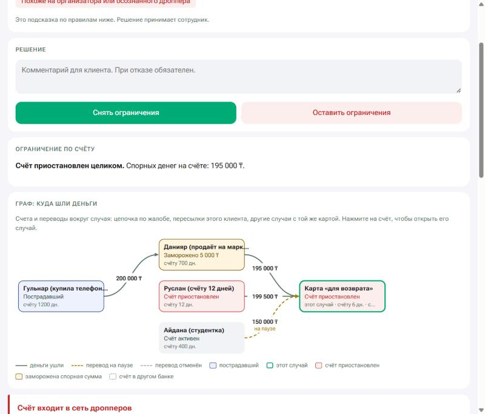
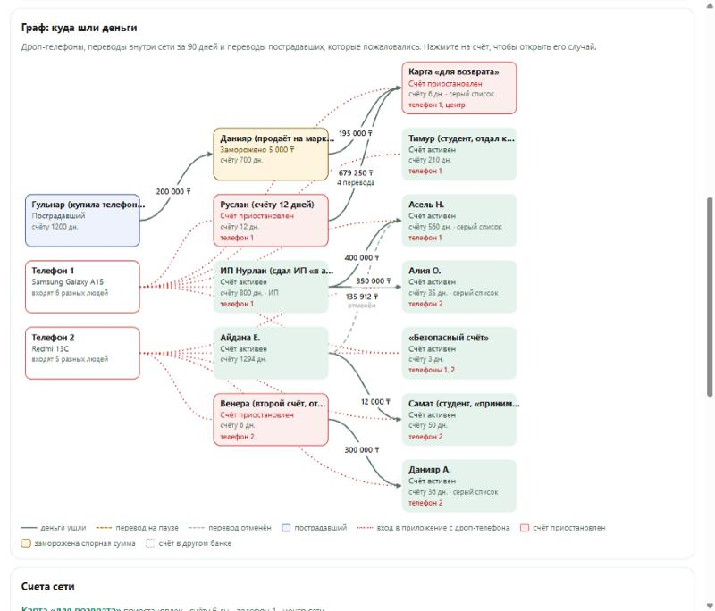

<p align="center"></p>

<h1 align="center">Clean Break</h1>

<p align="center"><b>Чужие деньги — не ваша проблема.</b></p>

<p align="center">
Защищаем честных клиентов банка от статуса дроппера и помогаем банку находить настоящих дропперов.<br>
Мобильное приложение и панель сотрудника для кейса Банка ЦентрКредит — V Региональный ITU Hackathon-2026.
</p>


## Проблема

Мошенники переводят человеку «по ошибке» чужие деньги и просят вернуть их на другую карту. Так студент или продавец, ничего не подозревая, становится звеном схемы. Потом его счёт блокируют — целиком и без понятных сроков, а пострадавший не знает, что стало с его жалобой.

С 2025 года в Казахстане заблокированы сотни тысяч дропперских счетов, и среди их владельцев много невольных участников.

## Решение

| Шаг | Как это работает |
| --- | --- |
| **1. Предупредить** | Пришли деньги от незнакомца — приложение сразу говорит «Возможно, это чужие деньги» и даёт вернуть их отправителю одной кнопкой. |
| **2. Остановить** | Мошенник уговаривает переслать деньги дальше — перевод останавливается, а клиент видит причину простыми словами. Так же работают звонок «из банка», «встречный кредит» и перевод под диктовку. |
| **3. Разобраться честно** | По жалобе пострадавшего система идёт по цепочке переводов. У невольного участника замораживается только спорная сумма, апелляция — прямо в приложении, со сроком ответа. Сотрудник видит граф денег и подсказку «невольный участник или организатор», а решение остаётся за человеком. |

## В цифрах

| Цифра | Что это значит |
| --- | --- |
| **88%** | переводов дропперам останавливает движок (10 наборов синтетических данных) |
| **0,20%** | честных переводов останавливается зря — и клиент сразу видит почему |
| **3 мс** | решение по одному переводу |
| **20+** | защит по всем пяти темам кейса и для рабочих процессов банка |
| **ru + kk** | все тексты для клиента на русском и казахском |
| **172** | автотеста |

## Что получает банк

- **Меньше возмещений.** Каждый остановленный перевод на счёт из базы Антифрод-центра — деньги, которые не ушли мошеннику. Панель эффективности считает это показателем «Не пришлось возмещать».
- **Меньше нагрузки на сотрудников.** Большинство остановок клиенты закрывают сами: возвращают деньги или отменяют перевод, без звонка в банк.
- **Меньше ложных остановок.** Порог движка выбран так, чтобы честных клиентов останавливали как можно реже.
- **Понятные решения.** Каждая остановка объясняется простыми словами, а у сотрудника видны все признаки и их вес.
- **Лояльность честных клиентов.** Невольный участник не теряет весь счёт и может объяснить, что произошло, прямо в приложении.

## Возможности

**Выявление мошенничества**
- Перехват пересылки чужих денег, дробления суммы и «сбора» денег многих людей
- «Встречный кредит» и перевод под диктовку: разговор во время перевода, вставка реквизитов, ссылка из мессенджера, новое устройство
- «Аренда ИП» и карта, работающая как касса онлайн-казино
- Дроп-фермы и сети дропперов: один телефон — счета многих людей

**Защита клиентов и их данных**
- «Возможно, это чужие деньги» и возврат отправителю одной кнопкой
- «Светофор получателя» — красный, жёлтый или зелёный ещё до перевода
- «Сейф» для сбережений, доверенное лицо, период охлаждения для крупных переводов
- «Счёт открыли без меня» — счёт, открытый на имя клиента по поддельному видео, приостанавливается одной кнопкой
- Скрытые ИИН и телефон, а клиент видит, кто и зачем открывал его данные

**Безопасность операций**
- Соразмерная блокировка вместо закрытия всего счёта
- Снятие наличных без карты: деньги незнакомцев банкомат выдаёт только после проверки по лицу, крупное снятие во время подозрительного звонка — через час
- Проверка QR-кода перед оплатой: подменённый код на парковке виден сразу
- Сигнал оператора о подозрительном звонке и списки Антифрод-центра

**Новые цифровые сервисы**
- Апелляция в приложении со сроком ответа и справка о снятии ограничений с проверкой по коду
- «Меня втянули в схему» — клиент сам сообщает банку и получает подтверждение с датой
- Статус жалобы для пострадавшего, жалоба через другой банк и готовое заявление в полицию
- Проверка подозрительного сообщения и тренажёр против мошенников

**Рабочие процессы банка**
- Карточка случая с графом денег и подсказкой «невольный участник или организатор»
- Очередь случаев, связанные счета, сети дропперов, запросы других банков
- Правило двух ключей: крупный возврат и решение в пользу похожего на организатора подтверждает второй сотрудник
- Журнал действий, который нельзя незаметно изменить задним числом
- Панель эффективности, калькулятор эффекта для банка и настройка весов по решениям сотрудников
- Выгрузка сведений для Антифрод-центра и АФМ

## Чем отличается от того, что уже есть у банков

| Уже есть | В Clean Break |
| --- | --- |
| Кнопка «вернуть отправителю» | Перехват пересылки чужих денег с объяснением, а не только кнопка |
| Блокировка дропперских счетов | Соразмерная блокировка, апелляция в приложении, справка с проверкой по коду |
| Поиск дропперов, который видит только банк | Работа с клиентом: «светофор», «Сейф», «Меня втянули в схему», «Счёт открыли без меня» |
| Жалоба в чат или колл-центр | Жалоба идёт по цепочке переводов, в том числе в другой банк; пострадавший видит статус |
| Статьи и викторины о мошенниках | Тренажёр в приложении на типичных схемах мошенников, а банк видит, где клиенты ошибаются |
| Отдельные правила против мошенников | Сети и дроп-фермы, «аренда ИП», касса казино, два ключа, журнал без подделок |

## Как это выглядит

| Клиент | Сотрудник банка |
| --- | --- |
|  |  |
| Перевод на «карту для возврата» остановлен: причины простыми словами и возврат отправителю одной кнопкой | Граф денег по жалобе, подсказка «невольный участник или организатор», скрытые данные клиента |
|  |  |
| Деньги незнакомцев банкомат выдаёт только после проверки по лицу | Сохранено, «Не пришлось возмещать», сколько остановок клиенты закрыли сами |



## Попробовать

Кнопка **«Показ за 3 минуты»** на стартовой странице проводит по проекту сама: 12 шагов от предупреждения клиенту до панели сотрудника и журнала. На экране клиента можно войти под любым из 20 персонажей:

| Персонаж | Что показать |
| --- | --- |
| Айдана | Пришли чужие 150 000 ₸ — предупреждение и возврат; попытка переслать их дальше останавливается |
| Гульнар и Данияр | Жалоба пострадавшей идёт по цепочке; у Данияра заморожена только спорная сумма |
| Мама | Звонок «из банка», «Сейф», доверенное лицо, период охлаждения, проверка QR-кода |
| Ерлан | Вербовка в «подработку»; снятие наличных только по лицу |
| Болат | «Встречный кредит»: перевод денег из кредита остановлен, кредит можно вернуть |
| Тимур | «Меня втянули в схему» — сообщить банку самому |
| Венера | Счёт, открытый на её имя по поддельному видео, — «Это не я» |
| ИП Нурлан и ИП Асель | «Аренда ИП» и честный магазин для сравнения |
| Самат | Карта как касса онлайн-казино |
| Сотрудник банка | Граф денег, правило двух ключей, сети дропперов, другие банки, эффективность |

## Безопасность

- Каждый запрос выполняется одной транзакцией: при ошибке изменения откатываются целиком.
- Журнал действий связан цепочкой отпечатков SHA-256: подделку записи проверка находит сразу.
- Документы клиентов хранятся зашифрованными (Fernet: AES-128 и HMAC-SHA256).
- Персональные данные в панели скрыты; каждый просмотр записывается и виден клиенту.
- Ограничение попыток входа, срок жизни сессий, запрет встраивания страниц в чужие сайты; страницы приложения не загружают скрипты и шрифты с чужих сайтов.
- Клиент видит только свой счёт, отправитель перевода берётся из сессии, а не из запроса.

## Как устроено

- **Сервер:** Python, FastAPI, SQLite.
- **Интерфейс:** HTML, CSS и JavaScript без фреймворков и сторонних библиотек; графы рисуются своим кодом в SVG.
- **Движок:** понятные правила вместо «чёрного ящика» — каждый признак даёт баллы и причину, которую видят клиент и сотрудник.
- **Качество:** страница `/quality` показывает результаты на 10 наборах данных и как они меняются с порогом остановки.
- Внешние системы — Антифрод-центр, оператор связи, другие банки, биометрия банкомата — в прототипе работают через имитацию с теми же событиями, которые пришли бы от них в банке.

| Где | Что |
| --- | --- |
| `app/engine.py` | Движок перехвата и подсказка «невольный участник или организатор» |
| `app/main.py` | API: переводы, жалобы, блокировки, апелляции, панель сотрудника |
| `app/metrics.py` | Эффективность, связанные счета, сети дропперов |
| `app/journal.py` | Журнал с цепочкой отпечатков |
| `app/i18n.py` | Тексты на русском и казахском |
| `app/static/` | Стартовая страница, экран клиента, панель сотрудника, эффективность, качество |
| `tests/` | Сквозные автотесты |

## Запуск

```bash
pip install -r requirements.txt
uvicorn app.main:app
```

Откройте http://127.0.0.1:8000 и нажмите «Показ за 3 минуты». Код сотрудника банка — `2026`.

Тесты: `python -m pytest -q`.

В проекте есть `Dockerfile` для хостинга (Render, Railway и любой сервер с Docker). Код сотрудника на сервере задаётся переменной `CA_ANALYST_PIN`.

---

<p align="center">V Региональный ITU Hackathon-2026 · FinTech-кейс Банка ЦентрКредит · ERA216</p>
